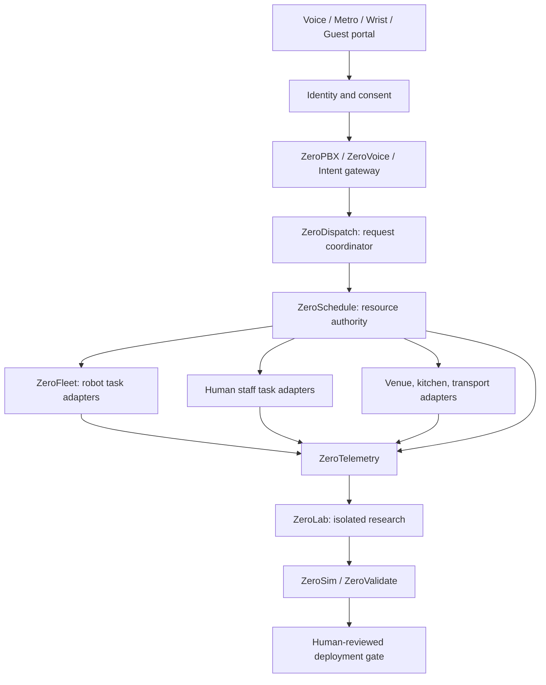

# ZeroCloud Architecture v0.1 (Draft)

## Purpose
ZeroCloud is a local-first distributed orchestration platform for a fictional/proposed estate combining private residence, hospitality venues, human staff, clankers (robots), transportation, and an AI research laboratory. This document defines intended interfaces, not implemented functionality.

## Logical architecture

## Control-plane invariants
- Every request has a unique ID, owner, authorization scope, priority, deadline, and auditable lifecycle.
- Requests are acknowledged before they are described as accepted; reservations are committed atomically.
- No schedule preemption without an explicit policy and an accountable decision.
- A request coordinator remains responsible for tracking delegated work through completion or escalation.
- Each user has private scheduling data; other principals see only authorized availability.
- Physical safety controllers operate independently of language models, network services, and personality systems.
- On network partition, local safety controls remain functional and services degrade gracefully; never promise global consistency while offline.
- Telemetry records measured vs estimated vs stale vs unknown and preserves provenance.
- Lab recommendations require tests, human review, and reversible rollout.

## Service boundaries
| Service | Responsibility | Does not own |
| --- | --- | --- |
| ZeroSchedule | Temporal constraints and multi-resource reservations | Physical safety interlocks |
| ZeroDispatch | Request intake, delegation, status and escalation | Unilateral permission escalation |
| ZeroFleet | Clanker identity, capability, health, OTA and task adapters | Guest private conversations |
| ZeroPBX / ZeroVoice | Call routing, authenticated voice interaction | Unbounded microphone access |
| ZeroRitual | Reusable user-approved timed workflows | Other people's consent |
| ZeroExperience | Hospitality package configuration and fulfillment | Covert guest surveillance |
| ZeroTelemetry | Operational events, metrics, provenance | Automatic model training rights |
| ZeroLab / ZeroSim | Offline analysis, simulations and model evaluation | Direct production control |
| ZeroCloud Metro | Authorized control and inspection interface | Safety override |

## Data and infrastructure
Start with event-driven interfaces and a durable append-only operational event stream; exact database, broker, protocols, and hosting choices remain ADRs. Prefer on-prem processing, encrypted transport, offline-capable task queues, scoped service identities, and retention policies by data class. A web UI, mobile Metro client, wrist interface, and voice client must use the same authorization layer.

## Open design questions
Robot hardware/capability contract; multi-site tenancy; transactional reservation algorithm; exact telemetry retention; interoperability with external calendars, retail checkout, and SIP providers; safety certifications for transport and physical automation.
