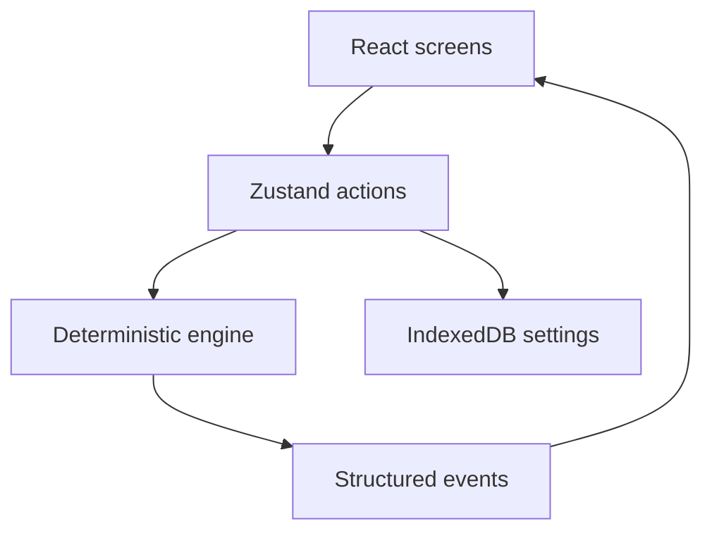

# Architecture

ADR 001: Keep the React/Vite app in playground/ beside the documentation. The simulation has no backend dependency and does not justify splitting the source repository. Hosted publication uses a sanitized copy of this subdirectory in the Site source repository; GitHub remains the review source.

ADR 002: Hash routing for portable static hosting. Zustand owns state, Dexie persists only user configuration. The engine uses pure cloned state transformations. React screens invoke store actions; views never send hardware commands.

The original household simulation remains a pure client-side demonstration. The resort simulator adds a separate local HTTP authority backed by a JSONL command journal and materialized snapshot. Restaurant confirmation changes table inventory, ZeroPay credits, employee protection and clanker assignment atomically. The client does not invent completion state; it reads receipts and current projections from the local API. A device-local IndexedDB outbox queues only reservation intents while disconnected. Those commands are revalidated on reconnection and can be marked rejected; the browser never labels a queued command confirmed.

The API binds to loopback and is an unauthenticated, single-writer development service. Guest/employee/operator selectors are prototype role previews, not an authorization boundary. Never put real guest, employee, or payment data in this app. The existing role filters are illustrative; a deployed shared system requires a separate identity, policy, and capability broker before it is exposed beyond one machine.
