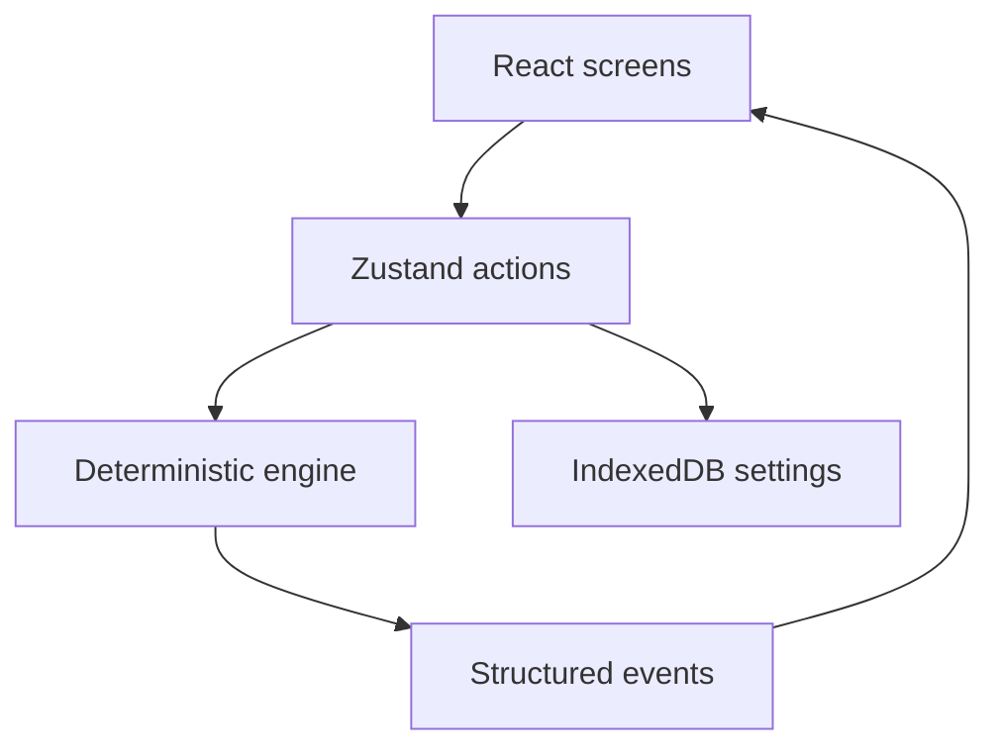

# Architecture

ADR 001: Keep the React/Vite app in playground/ beside the documentation. The simulation has no backend dependency and does not justify splitting the source repository. Hosted publication uses a sanitized copy of this subdirectory in the Site source repository; GitHub remains the review source.

ADR 002: Hash routing for portable static hosting. Zustand owns state, Dexie persists only user configuration. The engine uses pure cloned state transformations. React screens invoke store actions; views never send hardware commands.

Role filters are illustrative local controls, not authentication. No private real data should be entered. Persistence failures are surfaced in the shell. Simulation reset intentionally leaves browser configuration intact.

ADR 003: Use a local SVG schematic for the first map. `domain/map.ts` holds typed zone geometry and an explicit engine-location-to-zone mapping. `pages/Map.tsx` projects the existing simulation state without introducing a second fleet state or a map service dependency. Positions denote zones, not coordinates. Private task titles use the same canSee policy as other screens. The map contains no external tiles, location permission or tracking infrastructure.
