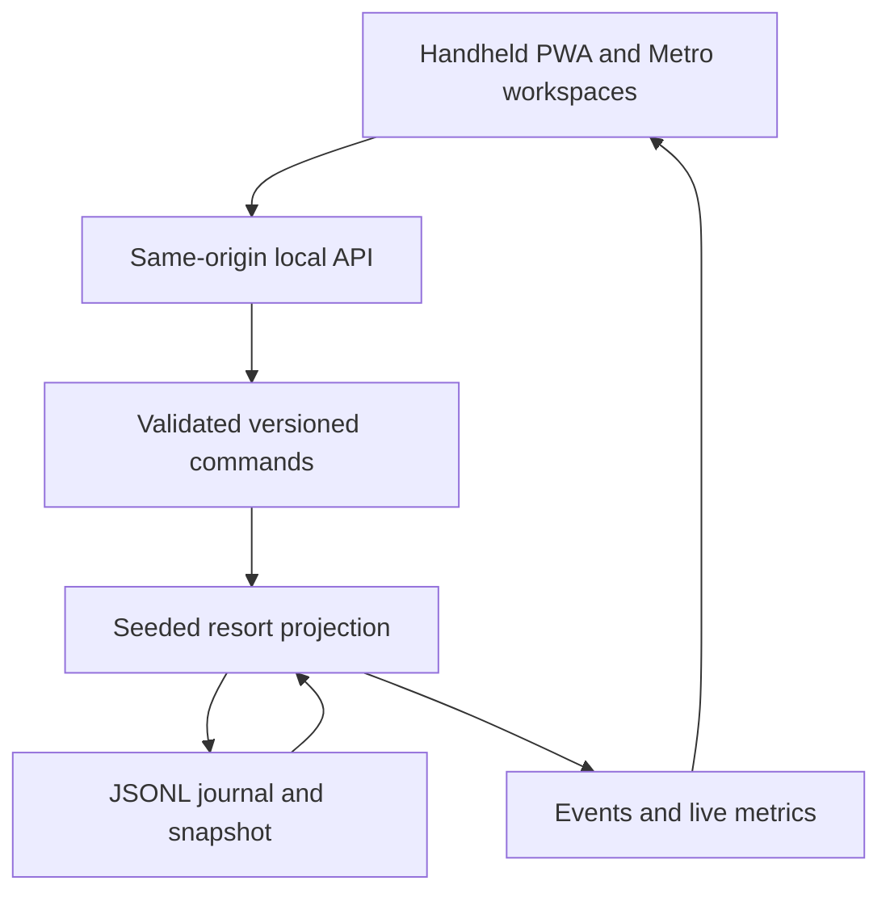

# Metro Hardware & Simulation v1 implementation

This implementation follows [Issue #4: Metro Universal Control Experience](https://github.com/softnessasastrength/zero-cloud-documentation/issues/4) and [PR #5: Metro hardware and simulation specification](https://github.com/softnessasastrength/zero-cloud-documentation/pull/5). The existing playground remains in place; the resort simulator and Metro workspaces extend it without replacing its household-service scenarios.

## Boundaries

- `src/domain/resort.ts` defines the versioned resort entities, command schemas, transaction rules, event emission and pure deterministic replay.
- `simulator/server.mjs` exposes state, events, commands, scenarios and replay over a loopback-only Node API. A serialized writer commits commands, journal entries and atomic snapshots.
- `src/domain/resort-api.ts` is the web API client. It caches the latest accepted view and uses a device-local IndexedDB outbox for reservation intents made while disconnected. Queued intents are not receipts; reconnect validation can reject them.
- `src/pages/ResortMetro.tsx` contains the employee/guest request, Mission Control and Engineering screens. Resort tiles in `Start.tsx` display values derived from these same API entities.
- `public/manifest.webmanifest` and `public/sw.js` define the installable PWA shell. The service worker caches static UI files; simulator API calls remain network-only.

## Scenario command trace

The restaurant reservation is an atomic domain command: check the real synthetic table interval, employee eligibility, current credit balance and idle fleet resource; then commit the table hold, 12-credit redemption, protected break, and clanker coverage together. A failed check leaves the supplied state unchanged. The protected interval begins at its scheduled virtual time. Dispatch moves the assigned clanker only when that interval starts and releases it when the break ends.

The experience-credit fixture calculates `eligible paid hours × 0.5`, without productivity inputs. Event envelopes keep virtual simulation time and wall-clock record time separate. Each event includes scenario, event, actor, subject, correlation, causation, schema, type and payload fields. The Engineering replay view rebuilds from the fixture seed plus the exact persisted command sequence and shows its state hash.

## Hardware and safety scope

Android PWA, Crostini, desktop, and dedicated kiosk targets use a shared web client. The local simulator includes no device adapters and makes no claims about physical robot performance. Windows Phone 8.x and Windows 10 Mobile remain research-only until a specific device, OS, toolchain, package/signing path, developer unlock, TLS/network support, and hardware smoke test are documented. See [hardware compatibility](HARDWARE_COMPATIBILITY.md).

The prototype's Guest, Employee, Proprietor, and Engineer views demonstrate product boundaries. The loopback development API has no production authentication or capability broker. Do not enter real guest, employee, payroll, booking or payment information. It is not suitable for shared or internet hosting.
